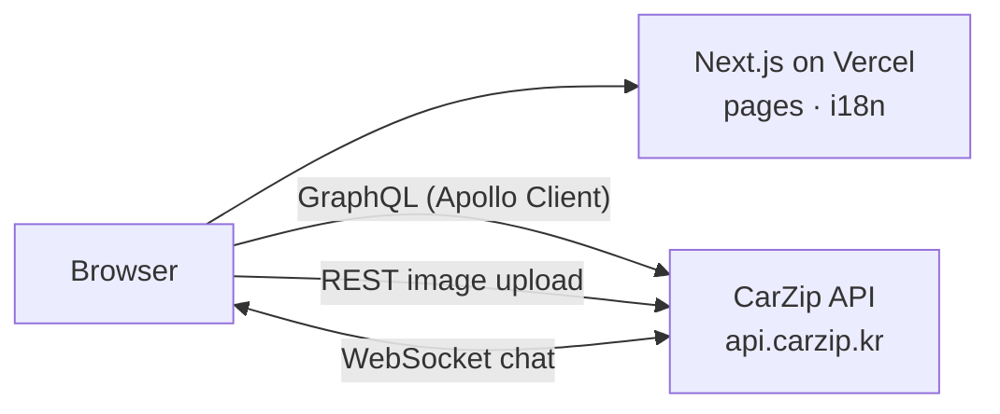

# CarZip — Web

**Next.js frontend for CarZip, a used-car marketplace in Korea where verified dealers list cars and buyers search, compare, chat and book test drives — in four languages.**


**Live:** [carzip.kr](https://www.carzip.kr) · **Backend repo:** [CarZip](https://github.com/sanchezSanjar/CarZip) (NestJS · GraphQL · MongoDB)

---

## Table of contents

- [Overview](#overview)
- [Features](#features)
- [Tech stack](#tech-stack)
- [Architecture](#architecture)
- [Project structure](#project-structure)
- [Getting started](#getting-started)
- [Internationalization](#internationalization)
- [Deployment](#deployment)
- [Author](#author)

---

## Overview

CarZip connects buyers with **verified car dealers** across Korea. Cars can be listed for the domestic market (KRW), for export (USD) or both, and every dealer is checked by an admin before listing. This repository is the website: a responsive Next.js app that talks to the [CarZip backend](https://github.com/sanchezSanjar/CarZip) over GraphQL, uploads images over REST and runs a live chat over WebSocket.

The site serves three kinds of users from one codebase:

| Role | What they do |
|---|---|
| **Buyer** | Search and filter cars, like and compare, follow dealers, comment, chat, request test drives |
| **Dealer** | List and edit cars, manage test-drive requests, write community articles, block unwanted members |
| **Admin** | Review dealer applications, moderate members, cars and articles, publish notices, FAQ and terms |

## Features

### For buyers
- **Car search** with brand → model catalogue, body type, fuel, region, price (KRW or USD), mileage, year and options, sorting and "load more" pagination
- **Car pages** with photo gallery and zoom, an animated odometer, export / rent / barter details, dealer contacts (phone, email, Kakao, Telegram, WhatsApp) and map links
- **Test-drive booking** with a date and time picker; the dealer sees the buyer's phone number only after confirming
- Favorites, recently viewed cars, follows, comments and a notifications page with an unread badge

### For dealers
- **"My cars" dashboard:** list a car with photo upload, edit, pause, mark as sold or delete, with tabs per status
- **Test-drive inbox:** confirm, decline, complete or cancel requests
- Community articles, comments on their listings and profile, personal block list, public contact details

### For admins
- Dealer applications with approve / reject (with a reason), dealer and user management
- Car moderation (hold with a reason, restore, delete), community moderation, notices / FAQ / terms editor

### Across the site
- **Live chat** (WebSocket) available on every page: guests read, members write; reconnects automatically
- **Four languages** — English, Korean, Russian and Uzbek — including server error messages
- **Responsive design** with a dedicated mobile layout (drawer menu, touch-friendly cards)
- Signup and password reset with **SMS verification codes**; separate flows for buyers and dealers
- Welcome page with live market numbers, top cars, top dealers, a region map and community highlights

## Tech stack

| Area | Technology |
|---|---|
| Framework | Next.js 16 (Pages Router, Turbopack), React 19, TypeScript |
| Data | Apollo Client 4 (GraphQL), reactive variables for session and chat state |
| UI | MUI 9, SCSS (separate desktop and mobile styles), SweetAlert2 dialogs |
| Real time | Native WebSocket with automatic reconnect and back-off |
| Auth | JWT stored on the client, decoded with `jwt-decode` |
| i18n | next-i18next (`en`, `kr`, `ru`, `uz`) |
| Code quality | ESLint 9, Prettier |
| Hosting | Vercel |

## Architecture



- **Apollo Client** keeps one normalized cache for the whole site. A like on one card updates every card showing that car; the cache is cleared on logout and reloaded when another member logs in.
- **Session state** comes from the access token: the header, menus and guards read the member's role from it, and an expired or revoked token logs the user out automatically.
- **Live chat** uses one shared WebSocket connection; it reconnects with exponential back-off and switches to the new token after login or a password change.
- **Business rules live on the server.** The UI mirrors them (for example, hiding the test-drive form on your own car), but the API makes the final decision and its messages are shown to the user, translated.

## Project structure

```
pages/                    routes (Pages Router)
├── index.tsx             welcome page
├── car/                  search · car detail
├── agent/                dealer directory · dealer page
├── community/            articles · article detail
├── cs/                   notices · FAQ · terms
├── account/join.tsx      login · signup · forgot password
├── mypage/               buyer and dealer dashboards
└── _admin/               admin panel (applications, dealers, users, cars, community, cs)
apollo/
├── client.ts             Apollo Client with auth and error links
├── socket.ts             live-chat WebSocket connection
├── store.ts              reactive variables (logged-in member, chat state)
├── user/                 queries and mutations for members
└── admin/                queries and mutations for the admin panel
libs/
├── components/           UI by area: homepage · car · account · mypage · admin · cs · common · layout
├── hooks/                reusable hooks (likes, locale formatting, device detection…)
├── auth/                 login, signup, OTP and token helpers
├── types/  enums/        TypeScript types mirroring the GraphQL schema
├── i18n.ts               translation helpers
└── upload.ts             image upload to the REST endpoint
public/locales/           translations: en · kr · ru · uz
scss/                     styles: pc/ (desktop) · mobile/ · theme
```

## Getting started

### Prerequisites

- Node.js 20 or newer
- The [CarZip backend](https://github.com/sanchezSanjar/CarZip) running locally (default `http://localhost:3007`) or a deployed API

### Installation

```bash
git clone https://github.com/sanchezSanjar/CarZip-next.git
cd CarZip-next
npm install
```

### Environment variables

Create `.env.local`:

```env
NEXT_PUBLIC_API_URL=http://localhost:3007
NEXT_PUBLIC_WS_URL=ws://localhost:3007
```

Both default to these local values when not set. In production they point to the deployed API (`https://…` and `wss://…`).

### Scripts

| Command | Description |
|---|---|
| `npm run dev` | development server on [http://localhost:3000](http://localhost:3000) |
| `npm run build` | production build (includes type checking) |
| `npm run start` | serve the production build |
| `npm run lint` | ESLint |

## Internationalization

Texts live in `public/locales/<language>/common.json` (`en`, `kr`, `ru`, `uz`), and the language switcher remembers the visitor's choice. Messages coming from the API are mapped to translation keys in `libs/serverMessages.ts`, so errors appear in the visitor's language too. Dates, numbers and prices are formatted per locale.

## Deployment

The site is deployed on **Vercel**; every push to the production branch builds and publishes a new version. Set `NEXT_PUBLIC_API_URL` and `NEXT_PUBLIC_WS_URL` in the Vercel project settings. The API must be served over HTTPS (and the chat over WSS), otherwise browsers block the requests from an HTTPS page.

The welcome-page background video is "Dolly Shot Video of Parked Vehicles" from [Pexels](https://www.pexels.com/video/dolly-shot-video-of-parked-vehicles-5982894/), used under the Pexels license.

## Author

**Sanjar** — [github.com/sanchezSanjar](https://github.com/sanchezSanjar)
